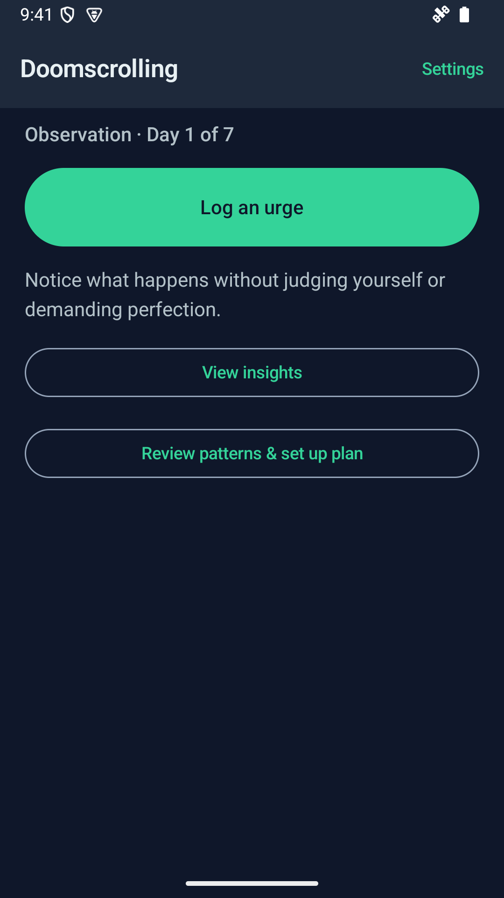
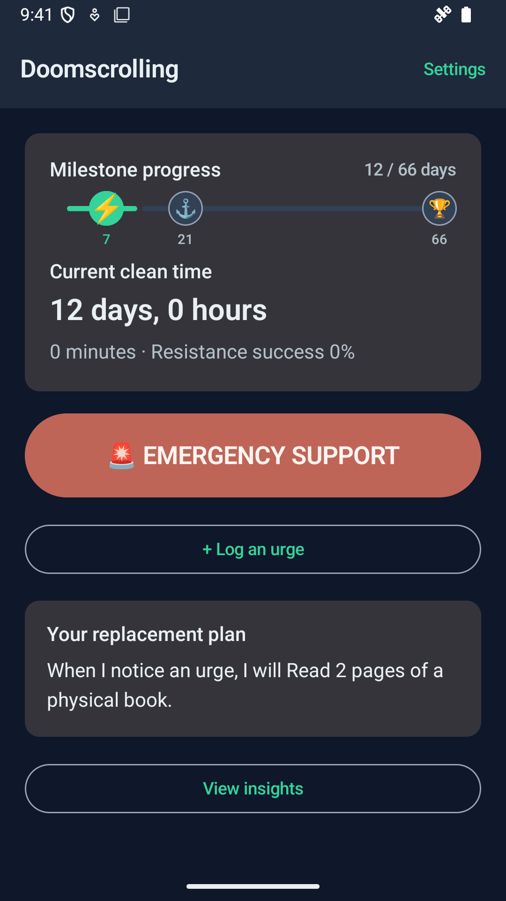
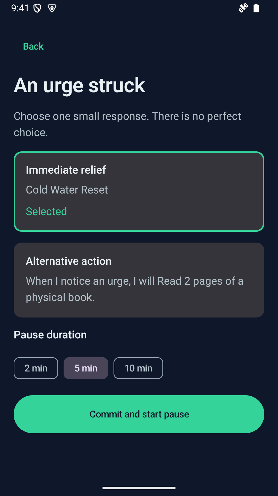

# ExHabere

<p align="center">
  
</p>

**Break the loop, one habit at a time.** ExHabere helps you start by observing urges without judgment, then turn what you learn into a personal action plan. When a craving hits, emergency support creates space to pause and choose a grounding technique or a healthier next step. Your journey stays on your device. Privacy is key, the app does not connect to any networks and keeps everything on your device only.

See [Specifications](Specifications.md) for the product requirements, UI and onboarding designs, technical architecture, and testing plan.

## Screenshots

<table>
  <tr>
    <th>Observe</th>
    <th>Take action</th>
    <th>Emergency support</th>
  </tr>
  <tr>
    <td></td>
    <td></td>
    <td></td>
  </tr>
</table>

## Build requirements

- JDK 17 or newer (the project compiles Java/Kotlin for JVM 17).
- Android SDK Platform 35 and Android SDK Build-Tools 35.0.0.
- Android SDK Command-line Tools, including `sdkmanager`.
- Internet access on the first build so Gradle can download its pinned distribution, Android Gradle Plugin, and Maven dependencies.

You do not need to install Gradle separately. The checked-in Gradle Wrapper uses Gradle 8.11.1. No signing key, API key, or other secret is needed to build the debug app.

Install the SDK packages and accept their licenses with the SDK command-line tools:

```sh
sdkmanager "platform-tools" "platforms;android-35" "build-tools;35.0.0"
sdkmanager --licenses
```

Set `ANDROID_HOME` and `ANDROID_SDK_ROOT` to your Android SDK installation directory. For example, on Linux or macOS with the SDK in the default location:

```sh
export ANDROID_HOME="$HOME/Android/Sdk"
export ANDROID_SDK_ROOT="$ANDROID_HOME"
```

On Windows PowerShell, set them for the current session (adjust the path if your SDK is elsewhere):

```powershell
$env:ANDROID_HOME = "$env:LOCALAPPDATA\Android\Sdk"
$env:ANDROID_SDK_ROOT = $env:ANDROID_HOME
```

## Build the debug app

Run these commands from the repository root.

Linux/macOS:

```sh
./gradlew :app:assembleDebug
```

Windows:

```powershell
.\gradlew.bat :app:assembleDebug
```

The APK is created at `app/build/outputs/apk/debug/app-debug.apk`. Install it on a connected device with `adb install -r app/build/outputs/apk/debug/app-debug.apk`, or install and launch it from Android Studio.

## Run checks

Unit tests and Android lint do not require an emulator:

```sh
./gradlew :app:testDebugUnitTest :app:lintDebug
```

Instrumented tests require a running Android emulator or a connected device with USB debugging enabled:

```sh
./gradlew :app:connectedDebugAndroidTest
```

Use `gradlew.bat` instead of `./gradlew` on Windows. To run the full local verification set, run all three tasks:

```sh
./gradlew :app:assembleDebug :app:testDebugUnitTest :app:lintDebug :app:connectedDebugAndroidTest
```

## Android configuration

- Application ID: `org.exhabere`
- Minimum Android version: Android 6.0 (API 23)
- Compile and target SDK: Android 15 (API 35)
- The app requests overlay, foreground-service, special-use foreground-service, and notification permissions for its optional emergency countdown.

The project does not configure a developer release-signing key. A release build, if generated, is not automatically signed for distribution. Keep signing credentials out of the repository.

## License

This project is licensed under the Apache License, Version 2.0. See [LICENSE](LICENSE) for the full license text and [NOTICE](NOTICE) for attribution.
